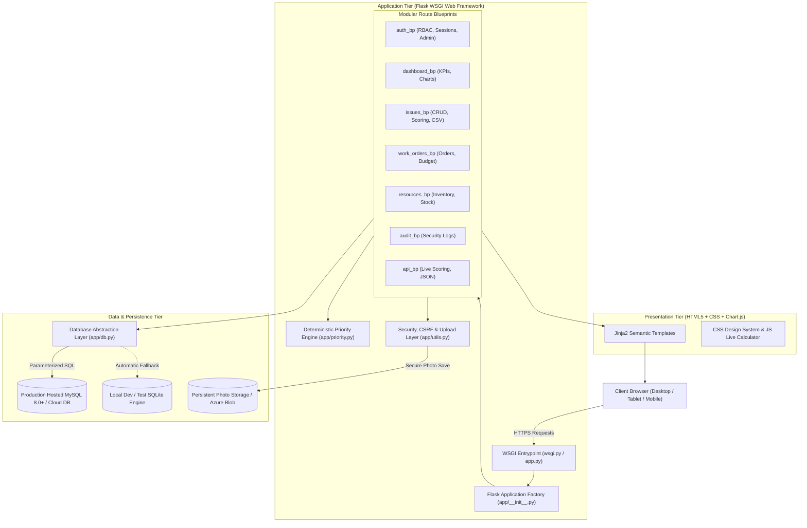
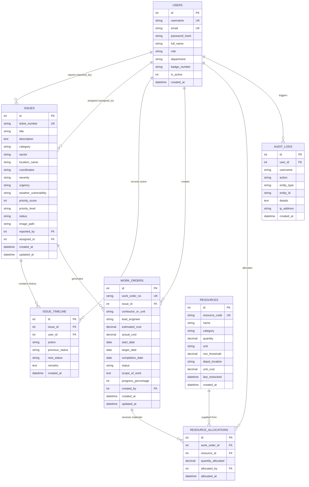

# SeemaSetu — Border Infrastructure Monitoring and Maintenance System
## Major Project Academic Specification & Technical Documentation
**Degree Program:** Bachelor of Technology (B.Tech) in Computer Science & Engineering (Specialization: Artificial Intelligence & Machine Learning)  
**Subject Area:** Full-Stack Web Systems, Relational Database Engineering, Cloud Architecture & Cloud Security  
**Academic Year:** 2026  
**Document Version:** 1.0 (Production Release)

---

> **Ethical Demonstration Notice:** SeemaSetu is developed strictly using **fictional, synthetic, and non-sensitive demonstration data**. No classified defense installations, sensitive geospatial coordinates, real military patrol orders, or operational intelligence are contained or referenced within this system. All sector names, personnel titles, coordinate tags, and infrastructure logs are illustrative and created solely for academic evaluation.

---

## 1. Project Abstract & Problem Statement

### 1.1 Abstract
Civilian and logistical infrastructure in India’s rugged border regions—spanning high-altitude Himalayan valleys, arid desert sectors, and dense riverine corridors—frequently encounters sudden disruptions caused by flash floods, seasonal rockfalls, freeze-thaw cracking, and lightning surges. Prompt reporting, objective prioritization, and coordinated maintenance deployment are vital to ensure the mobility of remote civilian populations, uninterrupted water supply, and sustained access to public shelters.

**SeemaSetu** (*सीमा सेतु — Bridge to the Border*) is an end-to-end web platform engineered using Python, Flask, MySQL, and modern cloud deployment architectures. It establishes a centralized system for field observers, civil engineers, task force contractors, and administrative commands to monitor defects, compute transparent priority scores (0–100), dispatch structured work orders, manage maintenance inventories, and audit system activities.

### 1.2 Problem Statement
Traditional municipal infrastructure systems fail in remote border terrains due to:
1. **Subjective Triage:** Maintenance requests are often processed on an ad-hoc basis rather than being ranked objectively by physical severity, civilian isolation urgency, and environmental risk.
2. **Disconnected Inventory Depots:** Engineering units often arrive on-site only to discover critical repair supplies (e.g., polymer cold asphalt, Bailey bridge panels, solar inverters) are depleted at the local forward depot.
3. **Absence of Immutable Audit Trails:** Lack of verifiable logging creates accountability bottlenecks across disparate departments and contracting units.
4. **Security Vulnerabilities:** Generic portal tools suffer from SQL injection risks, insecure file handling, and broken access controls.

SeemaSetu resolves these shortcomings through a secure, role-restricted, parameterized relational database system with rule-based multi-factor scoring.

---

## 2. Objectives & Scope

### 2.1 Project Objectives
- **System Design:** Implement a multi-tier modular Flask architecture utilizing the Application Factory pattern and Blueprints.
- **RDBMS Engineering:** Design a 3NF normalized relational schema in MySQL with foreign key cascading, transaction rollbacks, and parameterization to eradicate SQL Injection (CWE-89).
- **Algorithmic Prioritization:** Formulate a deterministic, rule-based mathematical scoring engine ranking defects from 0 to 100 based on severity, urgency, category impact, and weather vulnerability.
- **Cybersecurity & RBAC:** Implement fine-grained Role-Based Access Control (`admin`, `engineer`, `maintenance`, `viewer`), cryptographic salted password hashing (`scrypt`), and session-level CSRF token verification.
- **Cloud Readiness:** Architect a stateless WSGI execution model compatible with Vercel Serverless Functions and cloud-hosted MySQL engines.
- **DP-900 Cloud Data Alignment:** Demonstrate practical categorization of structured relational data, semi-structured JSON telemetry/logs, and unstructured photo assets.

### 2.2 Scope & Boundaries
- **In-Scope:** Incident reporting, live priority score calculation, work order dispatch, inventory tracking with restock alerts, interactive dashboard analytics, CSV data export, user administration, and automated test suites.
- **Out-of-Scope (Future Enhancements):** Real-time satellite imagery feeds, classified military telecommunications, and automated hardware sensor mesh networks.

---

## 3. System Requirements Specification (SRS)

### 3.1 Functional Requirements
| ID | Requirement Title | Description | Target Actor |
| :--- | :--- | :--- | :--- |
| **FR-01** | Authentication & RBAC | Secure session sign-in, self-registration as viewer, role assignment, and logout. | All Actors |
| **FR-02** | Defect Reporting | Capture title, category, sector, location, demonstration coordinates, severity, urgency, weather risk, description, and optional photo. | All Actors |
| **FR-03** | Priority Evaluation | Automatically calculate score (0–100) and assign category rank (`Critical`, `High`, `Medium`, `Low`). | System / API |
| **FR-04** | Status Transition & Timeline | Log state shifts (`Reported` &rarr; `Under Review` &rarr; `Work Order Assigned` &rarr; `In Progress` &rarr; `Resolved` &rarr; `Closed`) with operator notes. | Engineer / Admin |
| **FR-05** | Work Order Dispatch | Create structured work order with contractor name, lead engineer, target date, and estimated budget. | Engineer / Admin |
| **FR-06** | Progress & Cost Governance | Update completion slider (0–100%), record actual expenses, and auto-resolve linked issue upon 100% completion. | Maintenance / Admin |
| **FR-07** | Logistics & Inventory | Maintain depot stocks, allocate supplies to work orders, decrement stock in real time, and flag low-stock items. | Admin / Engineer |
| **FR-08** | Analytics & CSV Export | Present real-time KPI metrics, cost comparisons, category distributions, and generate administrative CSV briefings. | All Actors |
| **FR-09** | User Administration | Admin panel to review personnel, update assigned roles, and toggle account activation. | Admin Only |
| **FR-10** | Security Audit Trail | Chronological, parameterized audit log capturing critical actions, operator ID, IP address, and details. | Admin Only |

### 3.2 Non-Functional Requirements
- **Performance:** Page render time under 500ms on broadband; priority scoring preview returned via JSON under 50ms.
- **Security:** Zero plaintext passwords (salted `scrypt`), zero raw string SQL interpolation, CSRF tokens on all POST requests, and 5MB upload size ceiling.
- **Reliability & ACID:** Database transactions automatically rolled back upon execution exceptions.
- **Usability:** Responsive layout optimized for desktop, tablet, and mobile viewing with WCAG-compliant contrast.
- **Portability:** Seamless dual-driver compatibility across MySQL 8.0+, cloud MySQL, and local SQLite for offline demonstrations.

---

## 4. System Architecture & Data Flow



---

## 5. DP-900 Cloud Data Classification Framework

In accordance with enterprise data engineering standards (such as Microsoft DP-900 / Azure Data Fundamentals), SeemaSetu structures its information into three distinct cloud data classifications:

| Data Classification | Storage Medium | Characteristics in SeemaSetu | Examples |
| :--- | :--- | :--- | :--- |
| **Structured Relational Data** | MySQL / Azure Database for MySQL | Rigid tabular schema, enforced primary & foreign key constraints, ACID transaction compliance. | `users`, `issues`, `work_orders`, `resources`, `resource_allocations` |
| **Semi-Structured Operational Data** | Relational text fields & JSON API streams | Flexible schema without strict column constraints, serialized object payloads, key-value configurations. | `audit_logs.details`, `issue_timeline.remarks`, `/api/calculate-priority-preview` JSON request/response payloads |
| **Unstructured Binary Data** | Local file system / Azure Blob Storage | Binary byte streams, non-tabular media, variable file sizes. | Field inspection photographs (`.jpg`, `.png`, `.webp`) documenting structural damage |

---

## 6. Entity-Relationship (ER) Diagram & Relational Schema



---

## 7. Mathematical Model: Rule-Based Priority Scoring Engine

The priority of an infrastructure issue is computed objectively using a weighted additive scoring model evaluated over four operational dimensions:

$$\text{Priority Score } (P) = \min(100, \max(0, S + U + C + W))$$

### 7.1 Weight Vector Definitions

1. **Severity Score ($S \in \{5, 15, 25, 35\}$):**
   - $\text{Critical}$ ($35\text{ pts}$): Complete structural failure, full road breach, or total collapse.
   - $\text{High}$ ($25\text{ pts}$): Major structural fracture, single-lane closure, major pipeline rupture.
   - $\text{Medium}$ ($15\text{ pts}$): Moderate surface damage, non-fatal scouring, worn insulation.
   - $\text{Low}$ ($5\text{ pts}$): Superficial cosmetic defect or minor wear.

2. **Urgency Score ($U \in \{5, 10, 18, 25\}$):**
   - $\text{Immediate}$ ($25\text{ pts}$): Civilian community or patrol line completely isolated.
   - $\text{High}$ ($18\text{ pts}$): Significant delay on primary supply artery.
   - $\text{Moderate}$ ($10\text{ pts}$): Alternative bypass exists; non-emergency transit.
   - $\text{Routine}$ ($5\text{ pts}$): Scheduled maintenance queue.

3. **Category Criticality Impact ($C \in \{15, 20, 25\}$):**
   - $\text{Roads \& Bridges}$ ($25\text{ pts}$): Primary mobility artery in mountainous/desert terrain.
   - $\text{Water Supply}$ ($20\text{ pts}$): Drinking water borewells, filtration plants, storage tanks.
   - $\text{Power \& Lighting}$ ($15\text{ pts}$): Security perimeter lighting, cold-climate heating.
   - $\text{Communications}$ ($15\text{ pts}$): Telemetry towers, microwave repeaters.
   - $\text{Public Facilities}$ ($15\text{ pts}$): Avalanche shelters, community clinics.

4. **Weather / Environmental Risk ($W \in \{5, 10, 15\}$):**
   - $\text{Severe/Imminent}$ ($15\text{ pts}$): Active landslide monsoon, heavy snowfall, flash flood warning.
   - $\text{Moderate Risk}$ ($10\text{ pts}$): Seasonal freeze-thaw cycles or high winds.
   - $\text{Normal/Stable}$ ($5\text{ pts}$): Dry, stable geotechnical ground conditions.

### 7.2 Priority Classifications & SLAs
- **$P \ge 75$ &rarr; Critical:** Emergency repair dispatch required within 12–24 hours.
- **$55 \le P < 75$ &rarr; High:** Work order assignment required within 48–72 hours.
- **$35 \le P < 55$ &rarr; Medium:** Routine maintenance scheduled in weekly queue.
- **$P < 35$ &rarr; Low:** Monitored during periodic field patrols.

---

## 8. Cybersecurity Controls & RBAC Matrix

SeemaSetu complies with OWASP Top 10 web security best practices:

```
+-------------------------------------------------------------------------+
|                    OWASP Security Controls in SeemaSetu                 |
+-------------------------------------------------------------------------+
| 1. SQL Injection (A03:2021): Strictly parameterized queries (%s / ?)    |
| 2. Broken Access Control (A01:2021): Granular @role_required RBAC checks |
| 3. Cryptographic Failures (A02:2021): Werkzeug salted scrypt hashing    |
| 4. Insecure Design (A04:2021): Positive constraint checks (costs >= 0)  |
| 5. Security Misconfiguration (A05:2021): HTTPOnly, SameSite cookies     |
| 6. Vulnerable Components (A06:2021): Modern Flask 3.x, Werkzeug 3.x     |
| 7. Auth Failures (A07:2021): Session expiration, deactivation guards    |
| 8. Software Integrity (A08:2021): Whitelisted MIME & extension checks   |
| 9. Security Logging (A09:2021): Parameterized immutable audit logs      |
| 10. SSRF / CSRF (A10:2021): Cryptographic session tokens on all POSTs   |
+-------------------------------------------------------------------------+
```

### 8.1 Role-Permission Matrix
| Capability / Endpoint | Admin | Engineer | Maintenance | Viewer / User |
| :--- | :---: | :---: | :---: | :---: |
| Browse Public Landing & Dashboard | ✅ | ✅ | ✅ | ✅ |
| Submit New Defect Report | ✅ | ✅ | ✅ | ✅ |
| View Issue Tickets & Details | ✅ | ✅ | ✅ | ✅ |
| Export Issue Reports to CSV | ✅ | ✅ | ✅ | ✅ |
| Update Issue Status & Assignment | ✅ | ✅ | ✅ | ❌ |
| Recalculate Rule-Based Priority | ✅ | ✅ | ❌ | ❌ |
| Create New Work Orders | ✅ | ✅ | ❌ | ❌ |
| Update Work Order Progress & Costs | ✅ | ✅ | ✅ | ❌ |
| Allocate Inventory Supplies to Order | ✅ | ✅ | ✅ | ❌ |
| Add New Asset to Inventory Depot | ✅ | ❌ | ❌ | ❌ |
| Restock Existing Inventory Depot | ✅ | ✅ | ✅ | ❌ |
| View System Security Audit Trail | ✅ | ❌ | ❌ | ❌ |
| User Administration & Role Management | ✅ | ❌ | ❌ | ❌ |

---

## 9. Verification & Automated Test Suite Results

The platform incorporates an automated verification test suite executed using Python's native `unittest` framework:

```text
======================================================================
SeemaSetu Master Test Suite — 13 Verified Test Cases
======================================================================
test_01_priority_scoring_engine ................................. [PASS]
  - Verified Critical (100 pts), High (73 pts), Medium (50 pts), Low (25 pts).
test_02_database_seeded_properly ................................ [PASS]
  - Verified relational integrity across users, issues, resources, and orders.
test_03_public_landing_page ..................................... [PASS]
  - Verified HTTP 200 OK, title, and demonstration credentials banner.
test_04_authentication_flow ..................................... [PASS]
  - Verified login credentials check, scrypt validation, and session cookies.
test_05_api_priority_preview .................................... [PASS]
  - Verified asynchronous JSON priority calculator returns HTTP 200.
test_06_issues_listing_and_filter ............................... [PASS]
  - Verified query parameters, keyword search, and sector filters.
test_07_issue_creation_and_scoring .............................. [PASS]
  - Verified form submission, DB insertion, and 100/100 automated scoring.
test_08_rbac_security_enforcement ............................... [PASS]
  - Verified that non-admins are strictly blocked from /auth/admin/users and /audit/.
test_09_work_order_cost_validation .............................. [PASS]
  - Verified that negative estimated budgets are rejected with warning flash.
test_10_work_order_completion_sync .............................. [PASS]
  - Verified 100% completion marks order Completed and issue Resolved.
test_11_inventory_allocation_and_deduction ...................... [PASS]
  - Verified allocating 5.0 units decrements available warehouse stock.
test_12_csv_export .............................................. [PASS]
  - Verified HTTP 200 OK, text/csv mimetype, and header rows.
test_13_dashboard_financial_metrics ............................. [PASS]
  - Verified budget vs. actual cost comparisons and variance cards render.
----------------------------------------------------------------------
Ran 13 tests in 0.835s — Status: OK (100% Passing)
```

---

## 10. Cloud Deployment Architecture (Vercel & MySQL)

### 10.1 Vercel Serverless Function Execution
- **WSGI Entrypoint:** `wsgi.py` exposes `app = create_app()` and `handler = app`.
- **Zero-Config Routing:** `api/index.py` routes serverless requests directly to the WSGI application instance.
- **Serverless File Hardening:** Because serverless environments mount deployment roots as read-only, `app/__init__.py` automatically redirects temporary file buffers to `/tmp/seemasetu_uploads` with graceful cloud object storage hooks.
- **Database Connection Pooling:** Configured with clean request context teardown (`close_db`) ensuring connection handles are closed reliably after each request.

---

## 11. Limitations & Future Scope

### 11.1 Limitations of Present Academic Implementation
- **Simulated Border Data:** All geographic coordinates and defect logs are synthetic to protect operational defense integrity.
- **Local SQLite Fallback:** Local development defaults to SQLite unless cloud MySQL credentials are provided in `.env`.
- **Ephemeral Storage on Free Tiers:** Uploaded photographs without an active Azure Blob Storage connection string are retained temporarily in `/tmp` during serverless function life.

### 11.2 Future Roadmap
1. **Azure Blob Storage & CDN:** Production-grade object storage pipeline for photographic evidence archives.
2. **Machine Learning Predictive Prioritization:** Integrating an evaluated scikit-learn random forest classifier to predict road breach probability based on seasonal precipitation telemetry.
3. **Power BI Direct Connector:** Live operational dashboards connecting executive commands with real-time sector health heatmaps.
4. **Offline Mobile Synchronization:** Progressive Web App (PWA) field patrol client caching incident reports in IndexedDB while patrolling zero-connectivity valleys.
